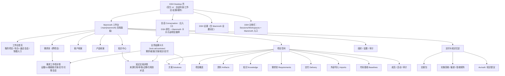
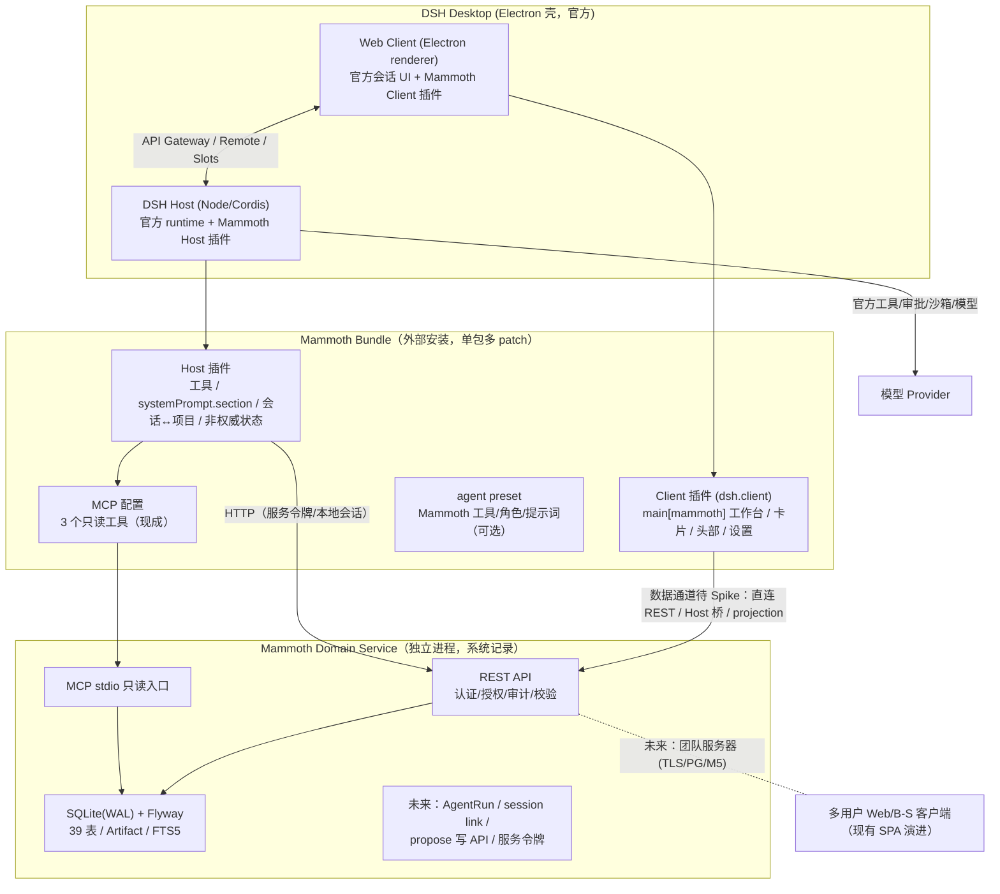

# Mammoth Agent — 产品形态与客户端架构重新评估报告

- **版本**：1.0（研究/设计稿，待负责人确认）
- **日期**：2026-11-13
- **性质**：只读研究 + 架构设计 + 建议。**本轮未修改任何产品代码、Domain Service、数据库迁移或 DSH 上游源码**。
- **研究基线**：仓库 `main` @ `fcc851c`（工作树 clean）；DSH Desktop `@deepseek-ai/dsh-desktop@0.2.2-rc.2`，payload `@deepseek-ai/dsh@0.2.2-rc.2`，Profile `desktop`，Web GUI `http://127.0.0.1:7277`。
- **证据附件**（本报告的事实底座，均含路径:行号）：
  - [`docs/evidence/2026-11-13-client-arch/01-repo-archaeology.md`](../evidence/2026-11-13-client-arch/01-repo-archaeology.md)（现有架构考古与复用评估，557 行）
  - [`docs/evidence/2026-11-13-client-arch/02-dsh-ui-extension.md`](../evidence/2026-11-13-client-arch/02-dsh-ui-extension.md)（DSH 客户端 UI 扩展能力，737 行，含 114 个 Slot 全集）
  - [`docs/evidence/2026-11-13-client-arch/03-dsh-runtime-host.md`](../evidence/2026-11-13-client-arch/03-dsh-runtime-host.md)（DSH Runtime/宿主/会话/权限，482 行）
- **关联决策**：[`decisions/ADR-0014-CLIENT-SHELL-AND-UI-EXTENSION.md`](../../decisions/ADR-0014-CLIENT-SHELL-AND-UI-EXTENSION.md)（草案，Proposed）
- **证据标记**：`[事实]` 有源码/官方文档直接支持；`[推断]` 由事实外推并注明依据；`[待验证]` 必须实测后才能作为承诺；`[未知]` 无证据，不作结论。

---

## 0. 结论摘要（先看这里）

### 0.1 核心判断

1. **当前实现的真实形态是"传统业务管理后台 + 外部只读 Agent 旁路"**，不是原始愿景中的"以 Agent 为主要工作入口的桌面工作平台"。这不是偷偷跑偏：它是 ADR-0001（不 Fork、out-of-tree 扩展、Domain API 独立）→ S1/S2 Spike（只有 MCP 只读边界被实测跑通、UI Slot 未做视觉验证）→ ADR-0002（B1 独立 SPA，M1 不嵌入 DSH）这条决策链的产物；但**"最终产品形态是浏览器后台还是桌面工作台"从未被任何 ADR 正式决策**，属于决策空白。`[事实 + 推断]`
2. **三条路线中，推荐以路线 A（DSH Desktop 为宿主 + Mammoth 外部 Bundle）作为 Desktop-first 的主路线**，保留路线 C（独立 B/S）作为长期演进，路线 B（自研 Electron 壳 + 集成 DSH Runtime）降为"路线 A 被实测否决时的备选"。理由不是"最简单"，而是：A 是 DSH 官方文档化的第三方扩展面，能同时拿到 DSH 原生 Agent 会话/工具/审批/沙箱/模型路由与完整业务工作台 UI；B 中"复刻完整 Desktop Host 的进程内嵌入组装"（认证 URL、boot injections、`dsh-app://` 载体、Electron 编排）没有第三方产品级文档与稳定性承诺（完整实现仅在私有 `dsh-desktop-host`；公开包只提供 `profile-boot`/`app-boot` 低层嵌入入口，且官方架构只承认具名 Profile 启动），SDK/ACP 又不足以替换官方 Client；C 是自研范围最大、周期最长的一条。`[事实 + 推断]`
3. **路线 A 的关键 UI 能力已由当前安装版证据确认（未实测渲染）**：0.2.2-rc.2 共有 **114 个 Client Slot**；其中 `main`（keyed，root）+ `sidebar.panellist`（list，root）组合可新增"左侧栏顶级入口 + 主内容区长期业务页面"，官方 `dsh-client-ui-plugin-manager` 就是同款范例；`tool.call.toolview` 可按工具名渲染业务结果卡片；`conversation.chat.node` 可加自定义会话行；`conversation.view` 可加会话内整页视图；bundle 的 patch 机制允许组合 Host 行、Client 行、MCP 行与 preset 片段（各自有官方样例，但**尚无官方 bundle 同时包含全部四类**，需 Spike 实测）。`[事实（契约/范例）+ 待实测（渲染/组合）]`
4. **路线 A 的最大技术不确定性不在 UI，而在"业务数据通道"与"上游 rc 契约稳定性"**：
   - 数据通道：第三方 Client 插件无法使用官方 UI 组件库、不能 iframe 嵌入现有 SPA、不能自行新增 Session 事件类型；第三方自建 Typert Remote namespace 需要仓库内生成器产物（是否可用 SRC 模式 `[待验证]`）。因此 Mammoth 必须实测确定 `Client UI → Domain Service` 或 `Client UI → Host 插件 → Domain Service` 的可行通道。
   - 契约稳定性：DSH 处于 rc，0.2.1→0.2.2-rc.2 已发生多起 Client slot/API 破坏性变更；`engines.dsh` 只做版本闸门，不保 API 兼容。Mammoth 必须建立"锁定版本 + 契约回归 + 升级窗口"机制。
5. **现有代码资产不需要推倒重来**：Domain Service（171 个 Java 文件 / 16.8k LOC / 107 个 API / 39 表 / 124 tests）与 DSH 完全解耦，三条路线都可高复用；现有 SPA（19 页 / 4.5k 行）在路线 B/C 下可高复用，在路线 A 下不能 iframe，但 `api.ts`（1.4k 行）、权限/格式化逻辑、部分组件与全部页面信息结构可以迁入 Client 插件（页面壳、路由、CSS 需重写）。**本轮不删除 `apps/web`、不修改 Domain Service、不改数据库。**`[事实]`
6. **产品边界不缩减**：本报告的 IA 仍覆盖客户/产品/项目/知识/需求池/方案/交付/知识沉淀/组织与审计，并额外补上当前缺失的"客户档案页、产品档案页、项目↔产品关联、跨项目需求池"。Desktop 化只是改变宿主与交互形态，不删除业务模块。`[设计承诺，需 ADR/验收约束]`

### 0.2 需要负责人确认的事项（进入下一阶段前）

| # | 决策事项 | 本报告建议 | 不确认的后果 |
|---|---|---|---|
| D1 | 是否确认"Desktop 优先、Agent 为主要工作入口"是产品形态目标 | 确认为 v1 客户端方向 | 客户端架构无法立项，继续按管理后台惯性演进 |
| D2 | 是否批准路线 A（DSH Desktop 宿主 + Mammoth Bundle）作为主路线、C 为长期演进、B 为应急备选 | 批准 A，启动 Spike | 无法开始插件工程与 UI 迁移 |
| D3 | 是否批准 ADR-0014（草案）并允许修订 ADR-0002 的 UI 宿主决策（B1→DSH 宿主 + 保留 SPA 作为后备 Web 客户端） | 批准修订方向；ADR-0002 状态更新以 Spike 通过 + ADR-0014 Accepted 为前置（此前 ADR-0002 保持有效）；后端技术栈不变 | 与已 Accepted 的 ADR-0002 冲突 |
| D4 | 是否批准 DSH 插件安装 Spike（安装/卸载外部 bundle 会执行 Host 代码、变更 Profile） | 批准、限定 DSH 版本 + 回滚方案 | 无法验证路线 A 的关键假设 |
| D5 | 是否批准"受控写操作与 AgentRun/Agent 身份"另立 ADR（V11 迁移、写工具、服务令牌、审批） | 单独立项，不与客户端 Spike 混合 | 客户端验证只能停在只读 |
| D6 | 团队服务器/B-S 的优先级（是否 M5 后再投入） | 保持 Domain API 优先、SPA 保留为管理台；B/S 客户端另立阶段 | 可能过早投入 B/S 造成双线作战 |

### 0.3 推荐架构一句话

> **Mammoth = DSH Desktop 内的一个外部 Bundle（Host 插件 + Client 工作台插件 + MCP 只读工具 + agent preset）+ 独立 Java Domain Service 作为系统记录与安全边界。**  
> 对话是主入口，业务模块是 DSH 主内容区的 Mammoth 工作台；项目上下文由插件注入会话；业务结果以自定义工具卡片回到对话；正式写操作一律经 Domain Service 的授权、审计与人工审批。

---

## 1. 研究范围、方法与证据

### 1.1 范围

- 还原现有真实架构（产品目标 / 已批准决策 / 代码事实 / 未实现能力四层分离）。
- 比较三条客户端架构路线（A/B/C）的 12 个维度。
- 设计 Mammoth 目标产品交互与信息架构。
- 设计 DSH UI Extension Spike（含"明确哪些能力已由官方文档/安装版源码确认、哪些必须在本地实测"）。
- 评估现有代码复用价值。
- 起草 ADR-0014。

### 1.2 非目标（本轮明确不做）

- 不修改 `apps/web`、不重构、不改 Domain Service、不改 Flyway 迁移、不改 DSH 上游源码。
- 不安装/启用/卸载任何 DSH 插件（属于运行环境实质变更，需单独批准）。
- 不把"最简单能跑通的技术方案"当成推荐方案；不以 Desktop 化为由削减业务边界。
- 不在本轮推翻任何 Accepted ADR；只提出 ADR 修订建议（ADR-0002 自身已写明"UI 如需嵌入 DSH → 另立 ADR 变更 B1 为 B2"）。

### 1.3 方法

1. 阅读任务指定文档、全部 ADR、M1–M4.5 规格与验收、Spike S1/S2/S3。
2. 代码考古：`apps/web` 全量、`services/domain` 全量、`integrations/dsh`、MCP 工具定义、迁移、测试。
3. 阅读本机安装版 DSH 0.2.2-rc.2 的官方文档与包源码（`dsh-doc` 技能 + ASAR 内 `docs/` + 包 README + 生成的 `slot-catalog.ts`）。
4. 交叉核对官方公开文档（`deepseek-harness.github.io` 的 slots/web-client/client-resources、GitHub `docs/architecture.zh.md`）。
5. 三个只读子 Agent 并行取证，产出三份证据附件；Lead 负责交叉核对、结论与 ADR。

### 1.4 证据可信度边界

- DSH 结论只对 `0.2.2-rc.2 + desktop profile + 2026-11-13` 成立；rc 期间 API/UI 契约会变。
- 本会话**没有** `cordis_inspect_*` 工具，无法查询 live slot 树与主题 token；使用官方生成的静态 `slot-catalog.ts` 作为替代证据，live 行为标 `[待验证]`。
- 未在本轮实际安装 Mammoth Bundle、未做浏览器视觉验证；"能渲染"来自官方文档 + 官方同款范例（`ui-plugin-manager`）+ 安装版 slot catalog，仍需 Spike 实测。

---

## 2. 第一部分：现有架构与原始产品愿景差异报告

### 2.1 四层事实分离

| 层 | 内容 | 结论 |
|---|---|---|
| **产品设计目标**（文档成文 + 本轮负责人前提） | 领域化 AI 工作平台；"AI 工作入口"（`docs/01-PRODUCT-CHARTER.md:9-11`）；分层的 UI 层明确含"Agent 会话入口"（`docs/05-ARCHITECTURE-BASELINE.md:13`）；领域模型定义 `AgentRun`（`docs/03-DOMAIN-MODEL.md:26,39`）；产品边界 8 条不可妥协原则（`docs/00-MASTER-GUIDE.md:15-22`）；本轮负责人补充"Desktop 优先、接近 Codex Desktop / DSH Desktop、Agent 会话与项目工作区为主界面" | **目标未变，且从未被"管理后台"取代** |
| **已批准架构决策** | ADR-0001（Accepted v1.0）：out-of-tree Bundle/Plugin + 独立 Domain API，不 Fork；MCP 为 Domain↔DSH 边界；业务权威状态不进 DSH storage。ADR-0002（Accepted v1.0）：Spring Boot 4.1.2 + Java 17 + Maven；UI 采用 **B1 独立 SPA**（由后端托管），M1 不嵌入 DSH Client slot。ADR-0003–0013：DB/Artifact/检索/身份/RBAC/Git/工作区/需求快照/外部集成/团队服务器/通知 | **只定了"集成方式 + 技术栈 + UI 实现方式"，没有定"最终产品形态"**；`docs/00-MASTER-GUIDE.md:127` 至今仍把集成形态列为待决 |
| **当前实际代码实现** | 独立 React SPA（19 页、无 Agent/会话路由）+ Spring Boot Domain Service（107 个 `/api` 端点、39 表、124 tests）+ 配置型 DSH MCP bundle（3 个只读工具、env 身份、JSONL 审计）+ Docker 单节点 | **是"业务管理后台 + 只读 Agent 旁路"** |
| **尚未实现的产品能力** | 应用内 Agent 会话/LLM、Agent 写操作与审批、AgentRun/AgentTask 模型、客户/产品档案页、项目↔产品关联、跨项目需求池、缺陷/问题等其它工作项类型、文档解析、向量检索、PG 多实例、多组织/SSO、桌面客户端 | **与原始愿景差距集中在"Agent 入口"与"档案/池化视图"，不在数据底座** |

### 2.2 当前真实架构（as-built）

```text
[浏览器] ──HTTP + 会话 Cookie/CSRF──> [Spring Boot Domain Service :8080]
                                        ├─ web：20 Controller / 107 个 /api 端点 + SPA 静态托管
                                        ├─ security：服务端会话、CSRF、BCrypt、登录限速、org_admin
                                        ├─ 18 个 Java 包（web/security/service + 15 个业务/基础设施包）：
                                        │   persistence/artifact/knowledge/workitem/
                                        │   solution/delivery/execution/baseline/git/external/
                                        │   notification/mcp/admin/config/support
                                        ├─ SQLite(WAL) <数据根>/db/mammoth.db + Flyway V1–V10（39 表）
                                        ├─ 内容寻址 <数据根>/artifacts/<sha256>
                                        └─ FTS5 全文检索（仅 verified、项目 scope）

[DSH Desktop 0.2.2-rc.2] ──stdio JSON-RPC(MCP 2024-11-05)──> [java -jar ... --mcp 只读进程]
                                        ├─ 3 个只读工具：search_project_knowledge /
                                        │   get_knowledge_document / get_requirement_context
                                        ├─ 身份 = MAMMOTH_MCP_AGENT_USER_ID（项目成员）
                                        └─ 审计 = <数据根>/audit/agent-audit.jsonl → writer 入库 agent_call
```

关键代码事实（证据见附件 01）：

- SPA 无 `dsh.client`、无 `__ModuleLoader__`、无 `ctx.slots`、无 `--dsw-*` 主题 token；是标准 `index.html + react-router` 独立应用（`apps/web/index.html`、`App.tsx:44-71`、`styles.css` 693 行）。
- 顶栏只有"品牌 + 通知 + 设置/用户 + 退出"；项目内导航 7 项：项目资料/知识文档/需求与方案/外部导入/代码基线/知识检索/成员与角色（`AppShell.tsx:36-57`、`ProjectLayout.tsx:19-27`）。
- 无 chat/conversation/agent 路由；无 LLM SDK（`services/domain/pom.xml` 依赖清单）；M2/M4/M5 计划连续明确"应用内 LLM/AgentRun 另立 ADR"。
- 后端有 `account_type=agent` 专用账号、`agent_call` 审计、BG-01 交接包 ZIP、`agent.task.*` Hook 通知，但**没有** `agent_run`/`agent_task` 表、应用内会话、Agent 写操作、工具审批。

### 2.3 决策链：为什么长成"独立 SPA + Domain Service + 只读 MCP"

| 步骤 | 证据 | 结果 |
|---|---|---|
| 1. 起点是"优先验证"，不是形态定案 | `docs/05-ARCHITECTURE-BASELINE.md:31`："优先验证：Mammoth Domain Core/API + 独立数据存储 + **DSH Bundle/Plugin UI/Agent Tools**"；`:1` 标题写明"提案，待 Spike/ADR 验证" | DSH 内嵌 UI 原本在验证清单内 |
| 2. S1 Spike 只验证到"工具/存储可用"，UI Slot 未做视觉验证 | `docs/spikes/S1-DSH-EXTENSION-SPIKE.md:72-75`（F2 依赖耦合；F5 "UI slot 未做视觉验证"）；`:152-159` 未验证清单 | UI 内嵌证据不足 |
| 3. S2 Spike 实测 MCP 边界可行、配置型 bundle 零 DSH 依赖 | `docs/spikes/S2-DOMAIN-API-MCP-BOUNDARY.md:54-59` | "Domain API + MCP"成为低成本可行路径 |
| 4. ADR-0001 采纳方案 B（不 Fork，out-of-tree，独立 Domain API） | `decisions/ADR-0001-DSH-INTEGRATION.md:61-85` | 保留 C 作为"扩展点不足"时的路径 |
| 5. ADR-0002 在"MCP 已可行"前提下选择 B1 独立 SPA，明确 M1 不嵌入 DSH slot | `decisions/ADR-0002-TECH-STACK.md:31-46`（尤其 `:36`、`:51`）；理由包括 Runtime Independence、避免 DSH client 插件构建/版本耦合、可独立浏览器测试 | **形态从此固定为浏览器后台** |
| 6. M1 UI-SPEC 把独立 SPA 定为"正式产品 UI 的基座"，把嵌入 DSH slot 列为非目标 | `docs/specs/UI-SPEC.md`（经附件 01 引用） | 后续里程碑不再讨论 UI 宿主 |
| 7. M2/M4/M5 连续排除应用内 LLM / AgentRun | `M2-PHASE2-PLAN.md:171-175`、`M4-PHASE4-PLAN.md:49`、`M5-PHASE5-PLAN.md:21,54` | Agent 侧只扩展只读 MCP（M2 加工具、M4 加审计/账号/Hook、M4.5 加 Jira 只读） |

**结论**：每一步都有文档依据，没有违规；**真正的缺口是"产品最终形态"从未被单独决策**。ADR-0001 决定的是集成方式，ADR-0002 决定的是技术栈与 UI 实现方式；两者合起来"默认"了浏览器后台形态，但没有一条 ADR 回答"产品是桌面工作台还是 Web 管理后台"。`[事实 + 推断]`

### 2.4 产品交互形态偏移判定

| 维度 | 产品目标 | 当前实现 | 判定 |
|---|---|---|---|
| 主要工作入口 | "AI 工作入口"；UI 层应含 Agent 会话入口 | 无 Agent 入口；顶栏/侧栏全是业务页面 | **偏移** |
| 客户端形态 | Desktop 优先（负责人本轮前提）；`docs/04` 要验证"桌面体验" | 浏览器 SPA，由后端托管，无 Electron/安装器 | **偏移** |
| 工作空间结构 | 项目空间围绕 Agent 工作 | 项目空间围绕业务对象（资料/知识/需求/导入/基线/检索/成员） | **偏移** |
| Agent 参与方式 | 归纳/检索/比较/给候选/拆分/生成/分析 | 仅 3 个只读 MCP 工具，由外部 DSH 调用；SPA 内无入口 | **部分偏移（只读旁路）** |
| 应用内 LLM/会话 | "Agent 辅助真实工作" | 无；且被三份阶段计划显式排除 | **偏移（被显式延期）** |
| Agent 身份/审计 | 需审计、可追溯 | Agent 账号 + MCP 审计 + 交接包 + Hook 已有，但身份仍是 env var、无运行级 AgentRun | **部分达成** |

**偏移性质**：不是"实现错误"，而是"产品形态决策缺位 + 阶段计划连续选择最小可交付业务闭环"造成的路径依赖。当前实现可作为**业务管理控制台**长期保留，但不能作为"Agent-first Desktop"的最终形态。`[推断，依据附件 01 §4.3]`

### 2.5 已实现能力 vs 产品边界（摘要，完整表见附件 01 §5）

- **完整**：用户/身份/会话、项目 RBAC、项目、资料、知识文档生命周期、全文检索（仅 verified）、需求证据/11 维就绪、统一 SolutionModel/双视图/任务/验收/四眼、代码基线（只读 Git）、交付闭环（交接包/实施回收/偏差/验收矩阵/As-built/知识提议）、站内通知、外部文件导入（含 Jira CSV）、MCP 只读工具、MCP 审计、BG-01 交接包。
- **部分**：组织（单组织）、客户（仅创建/列表，无档案页）、产品（同上，`project_product` 仅建表未使用）、需求池（仅项目内、仅 requirement 类型）、审计（API 有、管理 UI 无）、通知外发（默认关闭）、只读 API 集成（Jira 已 mock+smoke，CSM 无）。
- **未实现**：应用内 Agent 会话/LLM、Agent 写操作/审批、`AgentRun`、客户/产品档案页、跨项目需求池、其它工作项类型、文档解析（ADR-0009 OPEN）、向量检索、PG/多实例、多组织/SSO、桌面客户端。

### 2.6 文档/代码漂移与"决策债"

| ID | 类型 | 事实 | 影响 |
|---|---|---|---|
| D1 | 文档漂移 | MCP 接入模板 README 写"两个只读工具"，实际 3 个 | 接入/验收误判 |
| D2 | 计数口径 | `docs/05` 写"38 表"，实测 39 张 `CREATE TABLE`（含 `session`） | 文档不一致 |
| D3 | 边界缺口 | 领域文档要求项目可关联多个产品，但 `project_product` 无 Java/API/UI 使用 | 产品边界要求未落地 |
| D4 | 形态缺口 | `docs/05` 写 UI 层应有"Agent 会话入口"，实际无 | 形态决策缺位被文档掩盖 |
| D5 | 决策债 | `docs/00:127` 仍把集成形态列为待决；无产品形态 ADR | 当前实现被默认为产品形态 |
| D6 | 未验证 | S1 的 UI Slot 渲染从未验证 | 路线 A 曾因此被低估 |
| D7 | 产品化缺口 | MCP bundle 需手工替换 4 个占位符；Windows 重建 jar 前必须卸载 | 终端用户安装体验不可用 |

---

## 3. 第二部分：三条客户端架构路线比较报告

### 3.1 路线定义与评估口径

| 路线 | 定义 |
|---|---|
| **A. DSH Desktop 宿主 + Mammoth Bundle** | Mammoth 作为 out-of-tree bundle 安装进 DSH Desktop：Host 插件（工具/上下文/服务）+ Client UI 插件（`dsh.client`）+ MCP 配置 + agent preset。Mammoth Domain Service 独立运行。 |
| **B. 自研 Electron 桌面壳 + 集成 DSH Runtime** | Mammoth 自建桌面应用（自有 UI，现有 SPA 可直接作 renderer），通过官方支持的进程/协议方式集成 DSH Runtime；Domain Service 作为本地 sidecar 或远端服务。 |
| **C. 独立完整 B/S Agent 工作平台** | Mammoth 自建 Web 平台（多用户/服务端），自有 Agent 工作区/会话/工具/审批；DSH 只作外部 Agent 能力或开发工具，不作为产品 UI 骨架。 |

评估口径：以当前安装版源码/官方文档为事实；无证据处明确标注；"支持"指有官方文档或官方同款范例，不等于已在本机跑通。

### 3.2 十二维比较矩阵

| 维度 | A：DSH Desktop 宿主 + Bundle | B：自研 Electron 壳 + DSH Runtime | C：独立 B/S Agent 平台 |
|---|---|---|---|
| 1. UI 扩展能力 | **高**：114 Slot；`main`(keyed)+`sidebar.panellist` 可加顶级入口与整页；toolview/chat node/conversation view/rightbar/settings 均可扩展；受主题/locale 约束；**不能** iframe、不能导官方 UI 库、无应用级 router、不能替换 app root | **最高**：自有壳，UI 完全自由；现有 SPA 可直接复用；但聊天/会话/工具卡/审批 UI 全部自建 | **最高**：自有 Web UI，完全自由；现有 SPA 可作管理台；需新增 Agent 工作区 |
| 2. Agent Runtime 集成 | **原生最佳**：DSH 完整 runtime（模型路由、工具流水线、子代理/Team、skills、MCP、压缩、调度）随宿主提供 | **中**：只支持"子进程 + 具名 Profile + 协议"；SDK 显式能力窄（无 session 枚举/重命名/fork/删除/取消，新 `sessionId` 首次使用可隐式创建 agent；无 MCP 管理；模型仅 initialize 选定；无版本协商；审批仅 one-shot）；ACP 较宽但仍缺 fork/标题/计划/终端/展示数据；完整进程内组装仅私有 `dsh-desktop-host`（公开包只提供 `profile-boot`/`app-boot` 低层嵌入入口，无第三方产品级稳定性承诺） | **低-中**：DSH 只能作为外部执行单元（ACP/SDK）或完全自研 Agent Runtime；需自建 LLM 网关/流式/工具/审批/沙箱/压缩 |
| 3. 会话管理 | **高**：DSH 原生会话（append-only 日志、resume/fork/rename/归档；未发现正式删除 API；无自定义事件类型）；Mammoth 需自建"会话↔项目"关联（DSH 无 Project 概念） | **中**：SDK 无显式会话枚举/标题/删除/取消（新 `sessionId` 首次使用可隐式创建 agent）；ACP 有 list/new/resume/close + 模型切换，但无 fork/标题/展示；Mammoth 必须自建会话目录与元数据 | **自建**：需设计 `AgentSession`/`AgentRun` 持久模型、流式存储、多用户隔离 |
| 4. 项目上下文注入 | **中-高**：插件可注入 `systemPrompt.section`、`agent.inject`、skills、MCP tools/resources；但 DSH 的 workspace 只是"目录+会话分组"，没有业务项目实体；Mammoth 项目上下文必须由插件/Domain Service 提供 | **中**：SDK initialize 带 cwd/provider/model；ACP session/new 带 cwd + MCP；上下文靠 AGENTS.md/skills/MCP；项目模型自建 | **高**：直接由 Mammoth 服务端组装项目上下文、权限过滤与提示词，控制力最强 |
| 5. 自定义导航与业务页面 | **高（有官方范例）**：`main` keyed + `sidebar.panellist`；一次显示一个业务页，页面内多级导航/URL 需自建；reload 后选择重置；不能多窗口 | **最高**：自有导航/路由/多窗口；现有 19 页可直接迁移 | **最高**：自有信息架构；但 Agent 工作区需从零设计 |
| 6. 自定义 Chat Node / 业务卡片 | **高**：`tool.call.toolview`（按 wire tool name 渲染业务结果卡）；`conversation.chat.node` + 自定义 Definition；`conversation.view` 会话内整页；**不能新增 Session 事件类型**；action cards 属 experimental | **需自建**：协议事件可映射，但卡片/审批/工具 UI 全部自研 | **需自建**：同 B，且需多用户/权限下的展示一致性 |
| 7. 桌面文件与工作区操作 | **高**：DSH 原生 fs/shell/terminal/文件预览/目录选择器/工作区；Client renderer 无 Node 能力，须走官方 seam；与 Mammoth 业务文件（Artifact）需另一套通道 | **高**：自有 Electron 壳可做原生文件/多窗口；DSH runtime 提供沙箱内文件/Shell 工具；但需自建文件预览/审批 UI | **中**：B/S 文件上传/下载为主；桌面原生能力弱，除非另配壳（即 B） |
| 8. 本地数据与 Domain Service | **高（服务端复用）**：Domain Service 原样保留，作为 Agent 工具与 UI 的后端；**但 Client UI 到 Domain Service 的数据通道未验证**（自定义 scheme 跨源、CORS、Cookie/token、无第三方 Typert 生成器） | **高**：自研壳可同源加载 SPA + API，数据通道最直接；Domain Service 作本地 sidecar/远端；MCP 仍可用 | **最高**：服务端权威存储，REST/GraphQL 直连；多用户/多实例需 PG（M5） |
| 9. 安全与权限边界 | **中-高**：DSH 有文件沙箱 + 工具级审批（fail-closed），**但没有用户/RBAC/多租户**；插件 Host 代码在 Host 进程内执行、不受沙箱约束；因此**领域写操作必须走 Domain Service**，DSH 只作调用/展示/人工审批层 | **中**：自有壳新增进程信任/签名/更新/凭据边界；DSH 沙箱仍只约束工具；审批 UI 自建，容易漏 | **高**：可完整实现多用户认证/RBAC/TLS/审计/租户隔离；但自研范围最大 |
| 10. 开发及维护成本 | **中-高**：不用建聊天/会话 UI（最大节省）；需插件工程（TS/Cordis、Client bundle 构建、slot 适配、数据通道、主题/locale）、UI 迁移、版本升级跟踪 | **高**：Electron 壳 + 会话/聊天/工具/审批 UI + runtime 协议适配 + 签名/自动更新；但 UI 页面复用最多 | **最高**：自研 Agent Runtime 或适配层 + 多用户平台 + 部署运维；周期最长 |
| 11. 上游 DSH 版本升级影响 | **高耦合**：Desktop 自动更新 + rc 期 slot/API 破坏性变更；`engines.dsh` 只挡版本不保 API；必须锁定版本 + 回归 + 升级窗口 | **中-高**：可自控 DSH 包版本，但 SDK/ACP 明确 "pre-release, no compatibility promise"；若镜像私有嵌入则最高风险 | **低**：DSH 只作外部执行单元，适配层可替换；但自研 runtime 的维护成本转嫁到自己 |
| 12. 后续多用户与 B/S 演进 | **中**：Desktop 单用户；团队服务器可通过 Domain Service 提供；DSH Web 部署是单 owner（launch token + cookie），不能直接做多租户；长远仍需 Mammoth 自己的 Web 客户端 | **中**：桌面壳本身不解决 B/S；但自有 UI 可演进为 Web；DSH runtime 可按用户/会话部署 | **最高**：原生 B/S；多用户/租户/SSO 的归宿 |

### 3.3 路线 A 深度评估

#### 3.3.1 已由官方文档/安装版源码确认的扩展点（未做运行时实测；证据见附件 02）

| 能力 | 证据 | 置信度 |
|---|---|---|
| Client 插件模型：`dsh.client`（platform/inject/immediately/external）+ `./client` + lazy-CJS factory + React 从静态模块表取 | `dsh-package-manifest/src/types.ts:86-99`；`client-modules` README；`templates/decoration/*`；`ui-plugin.md:5-13` | 高 |
| 顶级导航入口 + 主内容区整页 | `main` keyed/root + `sidebar.panellist` list/root；`dsh-client-ui-plugin-manager/src/client/index.ts:82-86,129-173` 为官方同款范例；`ctx.layout.selectPanel(id)` | 高 |
| 业务结果卡片 | `tool.call.toolview`（keyed by wire tool name）；`dsh-client-ui-tool/README.md:38-56` | 高 |
| 自定义 Chat 行 | `ctx.uiConversation.events.register(definition)` + `conversation.chat.node`（key = definition.kind）；`practices.md:37` | 高 |
| 会话内整页 View | `conversation.view`；`ui-trajectory` / `ui-stats` 同款 | 高 |
| 右侧栏/底部条/overlay/toast | `rightbar`、`rightbar.session`、`sidebar.right.pane.tab`、`shell.bottom`、`shell.overlay`、`workspace.toast` | 高 |
| 设置页分区 | `settings.section`、`settings.section.icon`、`settings.general.item` | 高 |
| 头部/Composer 扩展 | `conversation.session.header.actions`、`conversation.composer.dock` 等 | 高 |
| 一个 bundle 同时含 Host+Client+MCP+preset | `dsh.bundle.patch` 支持有序多文件；`dsh-web-app` 用 5 个 patch；voice-input bundle 为 Host+Client 同包；MCP/preset 模板 | 高 |
| 主题 token / 多语言 | `--dsw-alias-*`、`ctx.locale.register/bind`、slot `locale`；zh/en 基线 | 高 |
| Desktop 与 Web 共用同一 Client 代码 | `dsh-web-frontend/src/main.ts`；`platform: 'web'` 同时服务 Desktop | 高 |

#### 3.3.2 明确不能做/高风险（决定架构设计）

| 限制 | 证据 | 架构含义 |
|---|---|---|
| 不能 iframe 嵌入现有 SPA | `practices.md:33`（官方实践：iframe 拿不到主题/locale） | 现有 SPA 页面必须迁为 slot React 组件或另开窗口；不能"零改造内嵌" |
| 不能新增 Session 事件类型 | `practices.md:21` | 业务卡片的数据必须来自工具结果、projection `wire.view`、既有事件或 Remote |
| 不能导入官方 Client UI 组件库 | `practices.md:35` | 需自建控件/CSS，复制 Host 交互模式 |
| 不能替换 app root / 加第二个应用 | `ui-plugin.md:13`、`practices.md:36` | 只能"寄生"在 DSH 壳内 |
| 无应用级 router；`main` 一次一个 keyed cell；layout 状态 reload 重置 | `ui-layout/README.md:12,36`；`slot-catalog.ts:2667` | Mammoth 工作台内部须自建导航/深链接；不要承诺浏览器式 URL |
| 第三方自定义 Remote namespace 通道不完整 | `dsh-typert-loader` README（只装载已生成 `./typert`；生成器不在安装包） | **必须 Spike 数据通道三选一**：C1 Client 直连 Domain REST / C2 Host 插件桥（session projection `wire.view`、`ctx.commands`、既有 Remote；自定义 Remote 是否可行单独判定）/ C3 工具结果/卡片降级 |
| 不能成为安装版 optional bundle | `dsh-official-bundles/README.md` | 分发方式需私有 bundle 安装/企业分发，安装体验受限 |
| rc 期契约不稳定 | `upgrade-guide` 13 个版本段；0.2.1→0.2.2-rc.2 多次 slot/API 破坏性变更；SDK 明确无兼容承诺 | 必须锁定 DSH 版本 + 契约回归 + 适配层 |

#### 3.3.3 路线 A 的主要不确定点（Spike 必须先验证）

1. **数据通道**：DSH Desktop 的窗口加载自 `dsh-app://app/`（自定义协议，Electron 主进程向私有 Host 转发；见附件 03 §1.3），其页面 `fetch` Mammoth Domain Service（`http://127.0.0.1:8080`）的 origin/CORS/私网访问/凭据行为均 `[待验证]`。Web profile 下页面来自 `http://127.0.0.1:<port>`，行为可能不同。
2. **会话↔项目绑定与会话创建**：第三方 Client 插件能否调用 `ctx.sessions`/session controller 创建会话、绑定项目；Host 插件能否拿到 `sessionId` 并注入项目上下文 `[待验证]`。
3. **Client 插件构建工具链**：官方 tsdown 预设不随运行时发布；需自建 esbuild 打包为 lazy-CJS factory（可行但需工程化）`[待验证]`。
4. **业务 UI 体量**：114 slot 足够，但"完整业务工作台"需要在 `main` 面板内自建导航、表格、表单、树、时间线、编辑器；不能借官方组件库，需自建基础控件（工作量大但可控）。
5. **启动性能**：Client 插件随 roster settle 后才首帧，大 UI 插件需测量 `[待验证]`。

### 3.4 路线 B 深度评估

**可行的官方集成方式**只有"子进程 + 具名 Profile + 协议"（附件 03 §2.1）：

- `dsh --profile web`：完整官方 Web GUI，自带反向代理部署路径；但 UI 是 DSH 的，不是 Mammoth 的。
- `dsh --profile headless`：一次性任务，NDJSON 事件流，无交互/审批响应通道。
- `dsh --profile sdk`：stdio JSON-RPC；显式能力窄（无 session 枚举/重命名/fork/删除/取消，新 `sessionId` 首次使用可隐式创建 agent；无 MCP 管理；模型仅 initialize 选定；无版本协商；审批仅 one-shot）。
- `dsh --profile acp`：ACP v1；有多会话/new/list/resume/close、模型切换、MCP、取消、权限请求；仍缺 fork/标题/计划/终端/展示数据。
- **进程内嵌入**：公开面存在低层入口——`@deepseek-ai/dsh` 导出 `./profile-boot`（Desktop Host 使用的 `runProfile` 来源），`dsh-app-boot` 为 public 包并说明其 boot helpers 面向 "lower-level embedders and tests"；但**完整 Desktop Host 组装**（`authenticatedUrl`、boot injections、`dsh-app://` 载体、Electron 进程编排）仅有私有 `dsh-desktop-host` 实现，且官方架构文档只承认"具名 Profile 启动"这一应用入口形式、排除绕过 launcher 的进程内直接挂载。因此复刻完整宿主属于"镜像私有实现 + 私有契约"，无产品级稳定性承诺；作为第三方产品的嵌入方式风险高。

> **混合形态说明**：除"自有 UI + SDK/ACP"外，还存在"自研壳 + 官方 Web GUI"（壳内窗口/iframe 承载 `dsh --profile web`，自有业务 UI 另开 surface）与"仅用 headless/SDK 做后端 Agent 服务"两种变体。均未作为主路线：官方 Web GUI 没有第三方嵌入契约（跨 surface 的认证、上下文、主题与审批难以打通，双窗口体验割裂）；headless/SDK 无交互式会话/审批 UI。若未来采用 B，建议**自有 UI + ACP 子进程**，把官方 Client 仅作为调试/对照。

**评估**：

- 优势：UI 完全自有、现有 SPA 复用最高、Domain Service 可同源直连、壳可控制多窗口/原生能力、升级时机自控。
- 劣势：必须自建聊天/会话/工具卡/审批/流式 UI（这正是 DSH 已经做好的部分）；若走 SDK 还缺会话管理；若走 ACP 仍缺展示数据；若复刻私有 Host 则契约风险最高；Electron 签名/更新/安全/进程编排均为新增工程。
- **结论**：B 的"资产连续性"最好，但"产品能力获取效率"最低、技术不确定性最高。适合作为 A 被否决（数据通道不可行 / UI 限制不可接受 / 需要独立应用品牌与多窗口）时的备选；若采用，建议收敛为 B1（ACP 子进程 + 自有 UI + Domain Service），不做进程内私有嵌入。

### 3.5 路线 C 深度评估

- DSH 能给：Agent Runtime 作为执行单元（ACP/SDK/headless）、部署形态（loopback + 反代 TLS + 单 owner 凭据）。
- DSH 不能给：多用户账号/隔离/RBAC/SSO/租户、业务领域模型、领域审计、稳定公开 API、服务化多副本。
- 评估：C 是"多用户 B/S 平台"的最终归宿，但把当前最大的空白（应用内会话/AgentRun/工具审批/LLM 网关）全部变成自研范围，且与 DSH 生态重复建设；若将来做，建议 **Mammoth 服务端编排 DSH 实例（每用户/每会话一个 runtime，经 ACP/SDK）**，而不是把 DSH 当平台骨架。
- **结论**：不在当前阶段作为主路线；作为长期演进保留。现有 Domain API + SPA 信息架构是 C 的种子资产，应继续维护，不应删除。

### 3.6 比较结论与选择逻辑

**推荐：A 为主路线，C 为长期演进，B 为应急备选。**`[推断，依据 §3.2–3.5]`

理由（按权重）：

1. **产品形态命中**：只有 A 能同时提供"Desktop 原生 Agent 会话 + 完整业务工作台同屏"，且不用自研 Agent UX；B/C 都需要自研聊天与会话（B 还要自研壳），与"优先 Desktop、Agent 为主入口"的诉求相比是重复建设。
2. **官方支持路径**：A 是 DSH 官方文档化的第三方扩展面（bundle/插件/slot/MCP/preset）；B 的完整进程内嵌入只有私有组装实现（公开低层 boot helper 不等于产品级嵌入契约），SDK/ACP 又不足以承载完整产品 UI。
3. **资产复用足够**：Domain Service/DB/权限/审计/MCP/后端测试 100% 复用；SPA 的 API 客户端、权限/格式化逻辑、信息结构与页面组件可迁移；UI 重写范围是"壳 + 页面组件"，不是"业务逻辑"。
4. **风险可控/可回滚**：A 的外部 bundle 可卸载、Profile 可备份；现有 SPA 保留为后备 Web 客户端；Domain API 保持独立，避免把 Mammoth 锁死在 DSH。
5. **反方观点（必须记录）**：附件 01 认为 B 与现有资产最连续、A 的 UI 是重写。本报告接受这一事实，但认为 A 的"UI 重写"是**有边界的页面迁移**（约 4.6k 行页面 + 业务逻辑复用），而 B 需要新增"聊天/会话/工具/审批/壳"一整套（远大于页面迁移），且其完整 runtime 嵌入组装无公开产品级契约；因此按"能力获取效率 × 风险"排序仍选 A。若负责人把"独立应用品牌/多窗口/完全自有 UI"列为硬需求，则 B 优先。

---

## 4. 第三部分：Mammoth 目标 UI 信息架构（IA）

### 4.1 形态定义与设计原则

**形态**：Mammoth 是 DSH Desktop 内的"项目智能工作台"。DSH 的会话界面是**主入口**；Mammoth 工作台是**主内容区的一个全局面板**，提供项目/客户/产品/需求池/知识/交付的完整业务视图。两者同屏、互相跳转、共享当前项目上下文。

**设计原则**：

1. **Agent 与业务同屏**：任何业务对象都能"一键带到对话里"；任何 Agent 产出都能"一键落回业务对象"。
2. **项目是上下文边界**：项目选择器全局可见；项目切换影响会话上下文、检索范围、业务列表。
3. **证据优先**：Agent 结论必须可追溯（知识引用、需求证据、方案版本、基线）。
4. **人工治理**：审批、四眼、确认动作永远由人触发；Agent 只能提议（propose），不能自批。
5. **DSH 壳不越界**：DSH 负责会话/工具/审批/沙箱/模型；Mammoth 负责业务领域/权限/审计/知识；不把业务权威状态写入 DSH storage。
6. **不缩减边界**：Desktop 化后仍必须有客户档案、产品档案、项目↔产品关联、跨项目需求池、知识中心、交付与沉淀、组织/审计。

### 4.2 IA 总览



### 4.3 DSH 壳与 Mammoth 工作台的职责划分

| 层 | DSH 官方壳 | Mammoth 工作台（Client 插件） |
|---|---|---|
| 左侧栏 | 会话/工作区列表、New Session、Settings、Plugins | 注册 1 个 `sidebar.panellist` 入口"工作台"（可另加"需求池/知识中心"快捷入口，建议先 1 个避免拥挤） |
| 主内容区 | 会话（默认）、官方面板（Plugins 等） | `main['mammoth']` 整页工作台，内部自建二级导航 |
| 会话 | 官方 Chat/Trajectory、审批、工具调用 | 项目徽章（header/leading）、项目上下文附加（composer dock）、业务结果卡片（toolview）、会话内 Mammoth View（可选）、Turn 尾部摘要（可选） |
| 右侧栏 | 文件/文档预览/终端等 | 可注册 Mammoth 右侧 tab（知识引用/相关对象），首版可不做 |
| 设置 | 模型/插件/通用设置 | `settings.section` Mammoth 分区（Domain Service 地址、登录/令牌、数据根、导入、通知） |
| 状态 | 会话/展示状态 | 当前项目、面板内导航状态（首版用 Client 本地状态；不写业务库） |

**关键交互**：DSH 左侧栏点击 "Mammoth 工作台" → `main[mammoth]` 面板；面板内点击"在对话中分析"→ 切回 Conversation 并注入项目/对象上下文；Conversation 头部项目徽章点击 → 回到工作台对应项目。

### 4.4 模块规格（用户在每个模块做什么）

#### 4.4.1 工作台首页（Home）

- **入口**：DSH 左侧栏 Mammoth 入口；或会话中的"返回工作台"。
- **内容**：当前组织/用户；我的项目（卡片：客户、产品、状态、最近活动、待办数）；待办聚合（待确认需求就绪、待批准方案、待审核知识、待审批的 Agent 提议、待回收实施、未读通知）；最近会话（按项目分组，显示会话标题/项目/时间）；快捷动作（新建需求、导入资料、开始分析、新建项目）。
- **Agent 协同**：待办项可"让 Agent 处理"（在对应项目上下文中打开会话）；首页顶部可"与 Mammoth Agent 开始工作"（新建会话，默认最近项目）。

#### 4.4.2 项目空间（Project Workspace）

- **入口**：项目卡片 / 项目切换器 / 客户档案中的项目 / 需求/知识/交付对象所属项目。
- **布局**：顶部项目上下文条（项目编码+名称、客户、产品、状态、当前基线、成员角色、`与 Agent 讨论` 按钮）；左侧项目二级导航（概览/资料/知识/需求池/方案/交付/外部导入/代码基线/成员与活动）；右侧可选上下文检查器（选中对象的详情/引用/相关会话）。
- **概览**：项目健康度（知识覆盖、需求状态分布、方案批准率、实施偏差、未闭环项）、最近活动时间线、风险与缺口、最近会话、快捷动作。
- **资料**：上传/列表/预览/下载、来源与 sha256、关联知识/需求；"让 Agent 阅读并提取知识"（生成草稿，人工审核）。
- **知识**：项目知识列表（状态筛选）、草稿/待审/已验证/已替代/已废弃；详情含来源引用、审核记录、过期提示；"在对话中引用"。
- **需求池（项目内）**：状态筛选、列表、详情（见 4.4.5）。
- **方案**：统一 SolutionModel 的业务视图/技术视图/任务/验收矩阵；版本与审批；"Agent 起草/对比/补全"（产出草稿，人批准）。
- **交付**：交接包、实施回收、偏差、验收矩阵、As-built、知识提议。
- **外部导入**：来源、预检、应用、批次、待映射记录、Jira 只读拉取。
- **代码基线**：注册本地仓库（只读）、捕获不可变基线、查看变更。
- **成员与活动**：成员角色（owner/editor/reviewer/viewer，org_admin 管理组织）、活动/审计时间线。

#### 4.4.3 客户档案（当前缺失，必须补）

- **入口**：全局导航"客户"；项目上下文中的客户名。
- **内容**：客户基本信息；关联项目（含状态与最近活动）；客户级知识 scope（合同/蓝图/管理约定/沟通履历，按权限可见）；决策记录；联系人（预留）；"与 Agent 讨论该客户/客户知识边界"。
- **权限**：org_admin 维护主数据；项目成员按成员关系看到相关项目；客户知识按 scope + 授权。

#### 4.4.4 产品档案（当前缺失，必须补）

- **入口**：全局导航"产品"；项目上的产品标签。
- **内容**：产品基本信息；产品版本（ProductVersion，边界要求，先列表+说明，版本管理后续）；标准知识（产品级 scope）；应用项目列表；产品级需求趋势（来自项目需求聚合）；"Agent 基于产品标准知识对比项目差异"。
- **项目↔产品关联**：必须落地（`project_product` 目前仅建表）；项目空间显示产品；产品档案显示项目。

#### 4.4.5 需求池（跨项目，当前部分缺失）

- **入口**：全局导航"需求池"；项目空间内需求 Pool（过滤到本项目）；工作台首页待办。
- **列表**：跨项目/客户/产品/状态/类型/负责人/优先级/标签筛选；列：编号、标题、项目、客户、状态、就绪度、最新方案版本、最近活动、关联会话。
- **详情**：需求头部（状态机、负责人、项目/产品、就绪度）；证据时间线（追加写、批次、来源 Artifact/Jira 映射、不可覆盖）；11 维信息完整度（missing/partial/confirmed/inferred/conflict）；上下文快照；方案版本列表；交付联动；关联 Agent 会话与结果卡片；人工确认动作（进入分析/就绪确认/批准方案——按角色）。
- **Agent 协同**：一键"让 Agent 分析缺口/生成方案候选/对比版本"；Agent 输出卡片可直接跳转对应区块。

#### 4.4.6 知识中心（当前部分缺失/分散）

- **入口**：全局导航"知识中心"；项目知识 tab 的全局视图；检索结果。
- **内容**：按 scope（Global/Organization/Product/Customer/Project/WorkItem）浏览；状态生命周期；全文检索（仅 verified）；来源引用与可追溯；过期/stale；知识提议待审；"引用到对话/需求/方案"。
- **Agent 协同**：检索结果可"让 Agent 基于这些引用回答"；Agent 只能读 verified 知识（现有 MCP 边界），草稿不可见。

#### 4.4.7 方案（业务方案 / 技术方案）

- **入口**：需求详情 → 方案版本；项目空间"方案"；会话里的方案卡片。
- **内容**：统一 SolutionModel 渲染的双视图（业务：现状/目标/角色/流程/规则/异常/执行/管理影响/验收；技术：模块/数据/接口/权限/兼容/异常/性能/安全/测试/部署）；任务拆解（可追溯到设计项/验收）；追溯矩阵；版本对比；评审与四眼批准；变更原因。
- **Agent 协同**：起草候选、补全缺口、生成任务、对比版本、检查一致性；Agent 不能自己批准；用户可在卡片上"查看/要求修改/提交评审/批准"。

#### 4.4.8 交付与知识沉淀

- **入口**：项目空间"交付"；需求详情"交付"；工作台待办。
- **内容**：交接包 ZIP（manifest/sha256/秘密扫描）、实施回收（baseline+commit→文件级变更）、任务完成、偏差分类、验收矩阵、As-built 快照（四眼）、知识更新提议（接受后生成知识草稿）、项目结项。
- **Agent 协同**：生成交接包摘要、分析偏差、起草 As-built/知识提议；外部 Coding Agent 的交付结果可通过手写/后续适配器回收。

#### 4.4.9 组织 / 设置 / 审计（当前部分缺失）

- **内容**：用户与 org_admin、Agent 账号、通知渠道状态（默认关闭）、导入来源、Domain Service 连接/登录、数据根/备份/导出导入入口、审计查询（当前只有 API，需补 UI）、DSH 插件设置（在 DSH Settings 的 Mammoth 分区）。
- **原则**：这些是治理页面，不是主工作入口；放在工作台内的"设置/组织"分区 + DSH Settings 分区两处合理分工。

#### 4.4.10 Agent 会话（DSH 原生 + Mammoth 扩展）

- **默认**：DSH Conversation 是主界面；进入即"与 Mammoth Agent 工作"。
- **Mammoth 增强**：
  - `conversation.header.leading` 或 `conversation.session.header.actions`：当前项目徽章 + 切换/新建项目会话。
  - `conversation.composer.dock`：当前引用上下文（项目/需求/知识卡片），可移除。
  - `tool.call.toolview`：Mammoth 工具结果卡片（需求摘要/就绪评估/方案草稿/知识引用/交付包）。
  - `conversation.chat.turnTail`（可选）：Turn 结束后的"保存到需求/知识"动作卡。
  - `conversation.view`（可选）：会话内"Mammoth 项目视图"tab，展示当前项目上下文与相关对象。
  - 会话↔项目绑定：由 Mammoth 维护（首版非权威本地状态；后续 Domain Service 权威记录）。

### 4.5 会话—项目—工作项关联设计

```text
Project (Domain Service, 权威)
  ├─ ProjectSessionLink (Mammoth 管理；v1 可为本地非权威映射，v2 入 Domain Service)
  │    └─ DSH SessionId ←→ ProjectId / WorkItemId / 用途
  ├─ WorkItem
  │    └─ AgentRun（未来，需 V11 迁移 + ADR）
  └─ KnowledgeDoc / SolutionVersion / DeliverySnapshot
```

- **绑定方式**：工作台选择项目 → "与 Agent 讨论"（或从需求/知识/方案详情发起）→ 插件创建/复用会话 → 写入 `sessionId→projectId` 映射 → Host 插件在会话中注入项目上下文（system prompt section + 工具集 + 可选 skills）→ 会话头部显示项目徽章。
- **权威性**：v1 的 session↔project 映射是非业务权威状态（可放 DSH `storageDomain` 或 Domain Service 的运营表）；`AgentRun` 的正式记录必须由 Domain Service 在写操作/工具调用审计中产生（后续 ADR）。
- **不变量**：DSH SessionId 不能当 ProjectId/WorkItemId；项目上下文以 Domain Service 数据为准；会话"删除"按归档处理（未发现正式删除 API）。

### 4.6 典型用户工作流（说明"用户如何在不同模块之间工作"）

1. **早晨开工**：打开 DSH Desktop → 左侧栏 Mammoth 工作台 → 首页待办看到"3 个需求待确认就绪、1 个方案待批准" → 点开需求 → 详情页看证据/11 维 → 点"让 Agent 分析缺口" → 切到 Conversation（项目徽章=该项目）→ Agent 调 Mammoth 知识工具 → 返回就绪评估卡片 → 用户点"确认就绪"（人工动作）→ 回到工作台继续。
2. **客户新需求**：客户档案 → 看到该客户项目 → 新建需求（归属项目）→ 导入邮件/会议纪要/Jira 记录为证据 → Agent 汇总冲突/缺口（证据批次只追加）→ 生成方案候选 → 方案页双视图评审 → 批准（四眼）→ 生成交接包。
3. **方案到交付**：需求详情方案版本 → 批准 → 交接包 ZIP → 交给外部 Coding Agent（DSH 会话或外部工具）→ 回收实施记录（baseline+commit）→ 偏差分类 → 验收矩阵 → As-built（四眼）→ 知识提议 → 知识中心发布（scope=项目/产品）→ 完成沉淀。
4. **知识复用**：知识中心按 scope 检索 → 打开文档看来源与过期提示 → "引用到对话"→ 会话中 Agent 基于引用回答（只读 verified）→ 产出方案时自动带引用。
5. **跨项目需求池**：需求池按客户/产品/状态筛选 → 发现某客户多个项目都有同类需求 → 打开详情对比方案 → 让 Agent 归纳共性 → 提议产品级知识/标准能力（人工确认后才能升级为产品标准，符合边界）。
6. **团队协作（未来）**：Desktop 连接团队 Domain Service（TLS/token）→ 登录 Mammoth 账号 → 项目成员/角色生效 → Agent 使用专用 Agent 账号 → 审计入库；多实例/PG 按 M5。
7. **纯业务操作（无 Agent）**：所有列表/详情/表单/审批都可在 Mammoth 工作台完成，不强制对话；Agent 只是一个"随时可叫的同事"。

### 4.7 审批、权限、审计在 UI 中的位置

- **DSH 工具审批**：Agent 调用需审批的工具时，DSH 原生审批 UI 出现；这是"这次工具调用是否允许"，不是业务审批。
- **Mammoth 业务审批**：方案批准、知识发布、As-built、需求就绪确认等在 Mammoth 工作台对象详情中完成；四眼规则由 Domain Service 强制（作者不可自批），UI 只显示可执行动作。
- **Agent 提议**：Agent 只能创建草稿/提议（propose），不能直接改正式状态；提议卡片显示"待确认"，人工在业务页面确认。
- **审计**：`audit_log` + `agent_call` + 后续 `AgentRun`；工作台"活动/审计"分区可查询（当前仅有 API，需补 UI）；DSH 侧会话日志是运行轨迹，不替代业务审计。

### 4.8 UI 约束对 IA 的影响（必须写进设计）

1. `main` 是单 keyed cell：Mammoth 工作台一次显示一个页面；二级导航/路由由 Mammoth 自建（Client 本地状态）；reload 后回到默认页（可接受，文档化）。
2. 无应用级 URL：跨模块跳转用 Mammoth 内部状态（如 `mammoth://project/PRJ-001/requirements/WI-123` 形式的内部路径或 store），不要承诺浏览器 URL。
3. 不能 iframe 现有 SPA：工作台页面必须是 Client 插件 React 组件；现有页面按组件迁移（见 §7）。
4. 主题/语言必须跟随 DSH：用 `--dsw-alias-*` token，提供 zh/en；不自绘全局主题。
5. 启动性能：Mammoth Client 插件应拆分为"壳 + 懒加载页面 chunk"（若第三方构建支持；否则控制首包体积）`[待验证]`。

---

## 5. 第四部分：推荐架构图与运行机制

### 5.1 推荐架构



**ASCII 简图**：

```text
┌──────────────────────────── DSH Desktop（官方壳） ────────────────────────────┐
│  Web Client（renderer）                          Host（Node/Cordis）          │
│  ├─ 官方 Conversation（主入口）                   ├─ 官方 agent loop/tools/     │
│  ├─ Mammoth Client 插件                           │   approval/sandbox/model    │
│  │   ├─ main[mammoth] 工作台                      ├─ Mammoth Host 插件          │
│  │   ├─ tool.call.toolview 业务卡片               │   ├─ mammoth_* 工具         │
│  │   ├─ conversation 头部项目徽章                 │   ├─ systemPrompt 项目上下文 │
│  │   └─ settings Mammoth 分区                     │   └─ session↔project 映射    │
│  └─ 官方会话/工作区侧栏                            └─ MCP client → Mammoth MCP   │
└───────────────┬───────────────────────────────────────────────┬──────────────┘
                │ 待 Spike 的数据通道（直连 REST / Host 桥）        │ stdio MCP（只读）
                ▼                                               ▼
┌──────────────────── Mammoth Domain Service（Java/Spring Boot）─────────────────┐
│ REST API（认证/RBAC/审计/四眼）  MCP 只读入口   SQLite+Flyway  Artifact  FTS5   │
│ 未来：AgentRun / agent_session_link / propose 写 API / 服务令牌 / PG(M5)        │
└───────────────────────────────────────────────────────────────────────────────┘
```

### 5.2 组件职责

| 组件 | 职责 | 禁止 |
|---|---|---|
| Mammoth Client 插件 | 工作台页面、业务卡片、项目徽章、设置分区、内部导航 | 不直接改数据库、不写 DSH storage 业务数据、不 iframe |
| Mammoth Host 插件 | Agent 工具（`mammoth_*`）、项目上下文注入（systemPrompt/agent.inject）、会话↔项目映射、调用 Domain API | 不绕过 Domain Service 做业务写、不在 Host 进程内实现领域规则 |
| MCP 配置 | 保留现有 3 个只读工具（verified 知识/文档/需求上下文），零 DSH 依赖 | 不扩展为写工具（写走 Host 工具 + Domain API + 审批） |
| Domain Service | 权威业务状态、权限、审计、四眼、检索、Artifact、MCP 只读入口 | 不依赖 DSH 会话/模型；不把 DSH 作为身份源 |
| DSH 官方 runtime | 会话、模型、工具流水线、审批、沙箱、子代理、skills、压缩、调度 | 不承载 Mammoth 业务权威状态 |

### 5.3 数据流与写路径

| 场景 | 路径 |
|---|---|
| Agent 读知识 | Agent → Host 工具/MCP 工具 → Domain Service（项目成员 + verified）→ 结果 → 工具卡片 |
| Agent 读项目上下文 | Host 插件注入 systemPrompt.section（项目卡）→ Agent → 工具（session 已绑定项目，工具无需模型传 projectId，降低误用） |
| Agent 提议写 | Agent → Host 工具 `mammoth_propose_*` → DSH 审批（工具级 ask）→ Domain Service `propose` API（创建草稿/提议，记录 AgentRun 引用）→ 返回提议卡片 → 人工在工作台确认 → Domain Service 正式状态变更（四眼/审计） |
| 人工业务操作 | Client 工作台 → Domain Service REST（登录会话/令牌 + CSRF/token）→ 权威变更 + 审计 |
| 知识引用 | 需求/知识选中 → 附加到会话上下文 → Agent 工具读取 |
| 审计 | Domain Service `audit_log`/`agent_call`（权威）+ DSH 会话日志（运行轨迹） |

**原则**：Agent 永远不能绕过 Domain Service 直接改数据库或正式状态；DSH 只做"调用方 + 展示 + 人工审批"。

**与 ADR-0001 的关系（边界变化必须显式）**：ADR-0001 §6.3 把 **MCP 定为 Domain API↔DSH 的推荐边界**。本报告建议保留 MCP 作为**只读**边界不变；新增的 Host 插件 HTTP 通道（`mammoth_*` 工具读 + propose 写）属于**对 ADR-0001 的边界扩展**，必须由"Agent 受控写操作/服务身份"独立 ADR 覆盖，并在该 ADR 中说明是否修订 ADR-0001 §6.3、以及写通道的认证/审计/审批/回滚。在独立 ADR 批准前，Spike 的写操作只允许在隔离 stub/分支中验证，不进入产品。

### 5.4 安全边界（延续 `docs/08-SECURITY-AND-TRUST.md`）

1. **系统记录**：Domain Service 是唯一权威；DSH storage/会话日志不是业务数据。
2. **身份**：桌面单用户用 Mammoth 本地账号登录（会话/token 由插件安全存储，优先 `ctx.credentials`）；团队模式连接团队 Domain Service；Agent 使用专用 `account_type=agent` 账号（不可登录、项目 viewer、MCP/服务身份）。
3. **插件信任**：bundle 安装执行 Host 代码——来源、签名/校验、版本、回滚必须记录；不安装未审计第三方 bundle。
4. **工具风险**：读写分级；写工具必须 DSH 审批 + Domain Service 授权 + 审计；Destructive 默认禁止。
5. **数据分级**：客户资料/源码/合同按 Confidential；凭据 Restricted 不进模型/日志/仓库；导出包按 Confidential 管理。
6. **不读取 `~/.dsh` 凭据/业务数据**（AGENTS.md 安全边界）。
7. **团队/公网**：TLS、反代、默认绑定 127.0.0.1；多租户/SSO 不在本轮。

### 5.5 版本与升级机制

- **锁定**：Mammoth Bundle 声明 `engines.dsh` 精确范围，`peerDependencies` + 开发依赖锁定到目标 DSH 版本（如 `0.2.2-rc.2`）。
- **升级流程**：DSH 新版本发布 → 读 upgrade-guide → 重新生成/对照 slot catalog → 重建 Client bundle → 跑契约回归（Spike/CI）→ 灰度/回滚。
- **回滚**：卸载 bundle（`plugin_manager remove_bundle`）+ 恢复 Profile 备份（升级前备份 `$DSH_PROFILE_DIR` 与 session 存储）；旧版本 Desktop 可回退。
- **适配层**：把所有 slot key/owner props/Client API 使用收敛到 `client/src/dsh-adapter/` 一层，升级只改适配层。
- **不承诺**：仅按官方模板使用 `window.__ModuleLoader__.load` 入口，不依赖 combo URL、`__DSH_BOOT__`、模块图内部协议等模板外细节（并收敛到 adapter 层）；不替换 shipped slot；不做私有 `dsh-desktop-host` 镜像。

### 5.6 多用户与 B/S 演进路线

```text
阶段 1（当前）：Desktop 单体 = DSH Desktop + Mammoth Bundle + 本地 Domain Service（SQLite 单写者）
阶段 2（可选）：Desktop 连接团队 Domain Service（TLS/反代/DB 会话；ADR-0012 S6）
阶段 3（M5）：Domain Service 切 PG + 多实例 + 共享 Artifact + 任务锁（ADR-0012/0003）
阶段 4（长期）：独立 Web/B-S Agent 平台（路线 C）：Mammoth 服务端编排 DSH 实例（ACP/SDK），
               现有 SPA 演进为管理台/Web 客户端，Client 插件页面作为可选桌面客户端
```

**不删除 SPA**：作为团队 Web 管理台、B/S 后备客户端、E2E 测试基座保留；其页面信息结构是工作台迁移的参考。

---

## 6. 第五部分：DSH UI Extension Spike 计划

> **前置声明**：本 Spike 涉及"安装外部 bundle（执行 Host 代码、变更 Profile）"与"可能的 Domain Service 小改动（CORS/token）"，均需负责人批准后才执行。本轮不执行。
>
> **执行结果（2026-11-16）**：Spike A 已完成并在真实安装的 DSH Desktop 0.2.2-rc.2 中通过 S-A0b、S-A1–S-A7；
> S-A2 数据通道结论为 **C2 Host 桥（Go）**；ADR-0014 已据此定稿 Accepted。完整报告、截图与调用记录见
> `docs/evidence/2026-11-13-client-arch/spike-A/SPIKE-REPORT.md`；bundle 源码在 `spike/dsh-desktop-integration`
> 分支的 `integrations/dsh/mammoth-bundle/`。

### 6.1 目标 / 非目标 / 前置

**目标**：用最小垂直切片证明路线 A 的 8 个关键假设（见 §6.2），产出 ADR 输入与可复用的工程骨架；不是做产品 MVP。

**非目标**：不迁完 19 页；不实现正式写业务；不改数据库迁移；不发布；不做多用户。

**前置**：

1. 负责人批准 D2/D3/D4（路线、ADR、插件安装）。
2. 锁定 DSH `0.2.2-rc.2`；备份 `$DSH_PROFILE_DIR`（只备份清单/配置，不导出会话业务数据）。
3. 独立 Git 分支/Worktree；Spike 产物放 `spike/dsh-mammoth-bundle/` 或 `integrations/dsh/mammoth-bundle/`（不影响产品代码）。
4. 隔离数据根（合成数据；`MAMMOTH_DATA_ROOT=%TEMP%\mammoth-spike`；不与真实数据混用）。
5. 明确回滚：`remove_bundle` + Profile 备份恢复 + 删除测试数据根。

### 6.2 已确认 vs 需实测（Spike 的假设清单）

| # | 假设 | 当前证据等级 | Spike 验证方式 |
|---|---|---|---|
| H1 | 外部 bundle（Host+Client+MCP+preset）可安装并激活；工作台入口与整页渲染 | 机制与各类样例 `[事实]`；**四合一组合与真实渲染 `[待验证]`** | S-A0/S-A0b/S-A1/S-A2 |
| H2 | `main[mammoth]` + `sidebar.panellist` 可长期停留并内部导航 | `[事实]`（slot catalog + plugin-manager 范例） | S-A2 |
| H3 | Client 插件能取得 Mammoth 数据（数据通道） | **`[待验证]`（最大风险）** | S-A2/S-A3（三方案对比） |
| H4 | 插件可创建/复用会话并绑定项目 | `[待验证]` | S-A4 |
| H5 | Host 插件可注入项目上下文（systemPrompt/工具） | `[事实]`（官方文档）；组合行为 `[待验证]` | S-A4 |
| H6 | Agent 在真实会话中调用 Mammoth 知识工具并渲染业务卡片 | MCP 单工具已实测（S2）；toolview 卡片 `[待验证]` | S-A5/S-A6 |
| H7 | 受控写操作：DSH 工具审批 + Domain Service 提议/四眼可串通 | 机制 `[事实]`；端到端 `[待验证]` | S-A7 |
| H8 | 桌面文件/工作区/目录选择器可用 | 官方文档 `[事实]`；插件组合 `[待验证]` | S-A8 |
| H9 | DSH 升级后 bundle 可重建（契约回归流程可执行） | `[事实]`（升级指南存在）；流程 `[待验证]` | S-A9（可延后到首个升级窗口） |

### 6.3 阶段任务（建议时间盒，按依赖顺序）

#### S-A0 准备与安装（0.5 天）

- 冻结 DSH 版本、备份 Profile、记录 Tool Catalog/Profile 组成。
- 建立 Spike bundle 骨架（`package.json` + `cordis.patch.yml` + `index.js` + `client.js` + locale/icon），**先只做 Host 侧最小工具**。
- 通过 `plugin_manager install_bundle`（或 **Plugins → Add plugin**）安装；记录 `application`/`warnings`。
- 通过：插件行 `applied`；新会话工具列表出现工具；卸载后工具消失。
- 回滚：`remove_bundle`；恢复 Profile 备份。

#### S-A0b 4 合 1 bundle 组合验证（0.5 天）

- 在同一 bundle 中组装：Host 工具行 + Client UI 行（`dsh.client`）+ MCP 配置行（复用现有 `dsh-mcp-client` 配置）+ 一个最小 agent preset 行；按 `dsh.bundle.patch` 多 patch 顺序应用。
- 通过：`install_bundle` 返回 `application: applied`；工具/页面/MCP/preset 四类内容均生效或可解释未生效原因；卸载后全部移除、Profile 恢复；`engines.dsh` 不匹配时安装被拒的负向验证。
- 说明：这是对"单 bundle 分发"前提的硬性验证；若四合一组合被上游限制，则改为"主 bundle + 独立 MCP/preset bundle"分发（需同步 ADR）。

#### S-A1 注册 Mammoth 导航与项目工作入口（1 天）

- Client 插件注册 `sidebar.panellist`（id=`mammoth`，中文 label、图标）+ `main` key `mammoth`（空页面/占位）。
- 点击左栏条目 → `ctx.layout.selectPanel('mammoth')` 打开页面；`usePanelInfo` 选中态；`null` 回 Conversation。
- 通过：真实点击可打开；主题深浅色/中英文正常；reload 后行为记录（预期回默认页）；控制台无 `slot entry crashed`；卸载后入口消失、样式清理。
- 回滚：停用 bundle；确认无残留。

#### S-A2 展示完整项目内容面板 + 数据通道三选一（2–3 天，**关键决策点**）

- 数据通道实验（按顺序）：
  - **C1 Client 直连 Domain Service REST**：Desktop `dsh-app://` 与 Web `http://127.0.0.1` 两种 origin 下 `fetch` `http://127.0.0.1:8080/api/...`；测试 CORS、预检、Bearer token/会话 Cookie、私网访问限制、CSP。
  - **C2 Host 插件桥**：Host 插件 `fetch` Domain REST，通过官方缝暴露给 Client：优先 `sessionProjection.wire.view`（会话数据）、`ctx.commands`（操作）、既有 Remote；评估是否存在可用的自定义 Remote（Typert SRC/生成物）。
  - **C3 只读工具 + 卡片**：不做通用列表，先用工具结果/卡片承载（作为降级方案）。
- 展示项目列表/项目概览（项目、客户、需求统计、知识数）——数据来自 C1 或 C2。
- 通过：数据真实、权限正确（非成员不可见）、无 CORS/凭据错误；记录三方案结论与风险。
- 失败处理：C1/C2 均不可行 → 路线 A 需降级为"A 轻量工作台 + 现有 SPA 独立窗口"，或转路线 B；提交 ADR 修订。

#### S-A3 选择项目并建立项目上下文（1–2 天）

- 工作台选择项目 → 当前项目状态（Client 本地 store + Host 非权威映射）。
- Host 插件 `systemPrompt.section` 注入项目卡（项目/客户/产品/状态/当前基线摘要）。
- 打开/新建会话（验证 `ctx.sessions`/session 创建路径）并绑定项目；会话头部项目徽章。
- 通过：新会话首轮请求包含项目上下文；切项目不串上下文；无权限项目不可选；映射在 reload/重启后的行为记录。

#### S-A4 创建/关联 DSH 会话（0.5–1 天，可与 S-A3 合并）

- 从需求/知识详情"在对话中分析"→ 创建或复用会话 → 注入需求/知识引用（`agent.inject` 或 composer 附件/工具参数）。
- 通过：会话出现在 DSH 侧栏；项目/对象引用可见；可继续多轮。

#### S-A5 Agent 使用 Mammoth 项目知识工具（1 天）

- 在真实会话中调用现有 3 个 MCP 只读工具（`mcp__mammoth_domain__*`）+ Host 工具；验证项目绑定后的工具参数解析、权限拒绝、审计 JSONL→`agent_call`。
- 通过：检索返回中文内容与引用；非成员被拒；草稿不暴露；审计入库 `agent_call`。

#### S-A6 渲染 Mammoth 业务结果卡片（1–2 天）

- 注册 `tool.call.toolview`（key=工具 wire name）渲染：需求摘要卡、就绪评估卡、知识引用卡（含跳转工作台动作）。
- 卡片动作：查看详情 → 打开 `main[mammoth]` 对应对象；复制引用；"保存到需求"（先做只读/跳转）。
- 通过：三阶段（preparing/start/result）渲染正确、失败态可见、深浅色正常、不 blank slot；卡片跳转可用。

#### S-A7 受控写操作与审批边界（2 天）

- Spike 用**隔离 stub**验证（不碰产品库）：Host 工具 `mammoth_propose_demo` → `ctx.approval.request()`（DSH 审批 UI）→ 调用 Domain Service 风格 `POST /propose`（stub 或隔离分支加的最小端点）→ 返回"待确认卡"→ 工作台人工确认 → stub 状态变更（记录 proposer/approver，四眼拒绝自批）。
- 负向：拒绝审批 → 无写入；Agent 不能自行批准；只读会话/只读模式下写被拒；审计有记录。
- 通过：审批拒绝/允许路径均可复现；Domain 侧四眼规则生效；不产生真实业务数据。
- 产出：受控写与审批边界的设计结论 → 输入独立 ADR（AgentRun/写工具/服务令牌/V11）。

#### S-A8 桌面文件与工作区（1 天）

- 目录选择器（`dsh-host-directory-picker*` seam）选择本地项目目录；Artifact 上传/下载走 Domain Service；验证 DSH 沙箱与 Mammoth 数据根不重叠（ADR-0008）。
- 通过：能选择目录并上传合成文件；不读取 `~/.dsh`；不写客户真实数据。

#### S-A9 升级回归演练（0.5 天，可延后）

- 记录当前 slot catalog/upgrade-guide；模拟一次 DSH 小版本升级（备份后），重建 bundle、跑 S-A1/S-A6 回归；记录 break 清单与修复量。
- 通过：形成可执行的升级 SOP 与回滚验证。

#### S-A10 启动性能与包体测量（0.5 天）

- 测量 Mammoth Client 插件对 Workbench 首帧/启动时间的影响（冷启动、插件启用/禁用对比）；记录 bundle 体积与懒加载情况。
- 通过：给出可接受阈值（如首帧增量 ≤ X ms，由负责人确认）与优化清单；若不可接受，记录为路线 A 的长期约束。

### 6.4 通过标准、证据与回滚

- **总通过标准**：S-A0b、S-A1–S-A8、S-A10 全部有可复现证据（S-A9 可延后）；"数据通道"与"会话↔项目"两大风险有明确结论；Spike 产物可回滚、不污染主仓库产品代码。
- **证据**：截图/录屏（脱敏）、slot 注册日志、安装返回值、审计记录、DSH 版本/Profile 组成；写入 `docs/evidence/2026-11-13-client-arch/spike-A/`。
- **回滚**：卸载 bundle；恢复 Profile 备份；删除测试数据根；Spike 分支不合并到 main（除 ADR/文档）。
- **决策门槛**：若 S-A2 数据通道不可行或 S-A7 审批边界不可接受 → 暂停路线 A，提交 ADR 修订，重新评估 B/C。

### 6.5 Spike 输出

1. 可行性结论（A 是否成立）+ 证据。
2. 工程骨架（bundle 目录结构、构建脚本、DSH 适配层、测试脚手架）。
3. 数据通道决策（C1/C2/C3 选型与理由）。
4. 受控写/审批边界设计（供独立 ADR）。
5. 升级 SOP 与回归清单。
6. ADR-0014 状态更新建议（Proposed → Accepted/Revised）。

---

## 7. 第六部分：现有代码复用评估

### 7.1 规模基线（附件 01 §1.2）

| 资产 | 规模 |
|---|---|
| 后端主代码 | 171 个 Java 文件 / 16,800 LOC；20 Controller / 107 个 `/api` 端点；18 个 Java 包 |
| 数据库 | Flyway V1–V10；39 张表（35 张导出表）；37 个 JPA Repository |
| 后端测试 | 38 个测试类 / 124 tests（沙箱内 2 个 Mockito 用例因 ByteBuddy 自附加被拒，属环境限制） |
| 前端 | 19 页 / 4,617 行；30 个非测试 TS/TSX / 6,599 LOC；`api.ts` 1,369 行；25 个 vitest；5 个 Playwright E2E |
| 演示/演练 | 8 个脚本（demo M1–M4、验收演练、admin drill、截图等） |

### 7.2 资产 × 路线复用矩阵

图例：**高**＝基本直接复用；**中**＝主体复用需适配；**低**＝大部分重写/仅参考。

| 资产 | A（DSH 宿主） | B（自研壳） | C（B/S 平台） | 说明 |
|---|---|---|---|---|
| Domain Service | **高** | **高** | **高** | 与 UI/Runtime 解耦 |
| DB/SQLite/Flyway/39 表 | **高** | **高** | **高**（团队阶段迁 PG） | 单机单写者与 Desktop 天然匹配 |
| 权限/会话/审计 | **中**：需为插件/桌面客户端增加 token/CORS/服务身份 | **高**：SPA 同源直连 | **高** | A 的跨源认证是 Spike 项 |
| 检索（FTS5 + 引用） | **高**（服务端） | **高** | **中高**（未来补语义） | UI 搜索页需迁移 |
| MCP（3 只读工具 + 配置 bundle + 审计） | **高**（现成） | **中高** | **中**（保留为外部 Agent 接口） | A 已按此设计 |
| SPA 页面（19 页/4.5k 行） | **低-中**：不能 iframe；页面需迁为 slot React 组件；`api.ts`/permissions/format/UI 组件可复用 | **高**：可直接作 Electron renderer / 本地服务 | **高**：管理台保留 | iframe 是官方实践禁止，不是技术不可能 |
| 测试资产 | **中高**：后端全复用；前端单测可复用；E2E 需新方式 | **高**：全复用 + 壳冒烟 | **高** | A 的 UI E2E `[待验证]` |
| DSH 集成资产 | **高**：就是为此设计 | **中高**：MCP 仍可用，关系反转 | **低**：仅外部 Agent 接口 | 现有配置型 bundle 零 Host 代码 |
| 视觉/信息结构 | **中**：信息架构可迁移，视觉需按 DSH 主题重做 | **高** | **高** | 自建控件/主题适配 |

### 7.3 分项结论与迁移映射

**直接复用（几乎零改动）**

1. Domain Service 全部业务逻辑/API/权限/审计/四眼/检索/Artifact/导入/通知/交付。
2. SQLite schema 与 Flyway（不新增迁移即可支撑 Spike；后续 AgentRun/session link 需 V11 + ADR）。
3. 现有 MCP 只读工具与配置型 bundle（`integrations/dsh/mammoth-domain-mcp/`）——直接并入 Mammoth bundle 的 patch 或保留独立安装。
4. 后端 124 tests 与演练脚本。
5. 前端纯逻辑：`lib/api.ts`（需改为可注入 base URL/token 的客户端）、`permissions.ts`、`format.ts`、`pagination.ts`、部分 `components/ui.tsx` 思路。

**迁移改造（路线 A）**

| 现有页面 | 迁移目标 | 工作量 |
|---|---|---|
| `ProjectsPage` 的客户/产品创建表单 | 客户/产品档案页 + 创建向导 | 中（并补齐档案页） |
| `ProjectLayout` 侧栏 | 工作台内部导航（自建） | 中 |
| `ArtifactsPage` / `KnowledgePage` / `KnowledgeDetailPage` / `SearchPage` | 项目资料/知识中心/检索 | 中 |
| `RequirementsPage` / `RequirementDetailPage` / `SolutionPage` | 需求池/需求详情/方案 | 中-高（页面最大，4.5k 行中约 1.5k） |
| `DeliveryPage` / `ImportsPage` / `BaselinesPage` / `MembersPage` | 交付/导入/基线/成员 | 中-高 |
| `SettingsPage` / `NotificationsPage` / `LoginPage` / `SetupPage` | Mammoth 设置分区 / 通知 / 登录（桌面单机可简化） | 中 |
| `AppShell` / `App.tsx` 路由 | 工作台壳 + 内部状态导航 | 重写（小） |
| `styles.css`（693 行） | DSH 主题 token + 自建控件样式 | 重写（中） |

**必须新建（所有路线都需要的业务补齐）**

- 客户档案页、产品档案页、项目↔产品关联（`project_product` 落地 + API + UI）。
- 跨项目需求池（全局 API + 页面）。
- 审计管理 UI（当前只有 API）。
- Agent 提议/确认的工作台呈现（受控写）。
- 会话↔项目关联与 AgentRun（后续 ADR + V11）。
- （路线 A 专有）Client 插件工程骨架、构建脚本、DSH 适配层、业务卡片、项目徽章、数据通道、插件安装/升级流程。

### 7.4 粗略工作量（数量级，仅用于排序，不是承诺）

| 阶段 | 内容 | 粗估 |
|---|---|---|
| Spike（§6） | 安装/导航/面板/数据通道/上下文/卡片/写审批（含 S-A0b、S-A10） | 约 2.5–3 周（11–15 人天，单人，含环境问题） |
| 工作台骨架 + 项目/需求/知识/资料核心页面迁移 | 壳、导航、API 客户端、主题控件、4 大模块 | 4–6 周 |
| 客户/产品档案、需求池全局、交付/导入/基线/成员/设置迁移 | 补齐边界 + 迁移 | 4–6 周 |
| 受控写/审批/AgentRun/审计 UI（独立 ADR 后） | 需后端 V11 + 新 ADR | 4–6 周 |
| 升级/发布/回归/文档 | 版本锁定、CI、安装包 | 持续 |

> 说明：以上为"完成产品边界所需"的量级，不允许用"Desktop 化"裁剪；若负责人要更快，只能调整顺序（先核心纵向闭环），不能删模块。

### 7.5 本轮代码保护要求落实情况

- 未删除/修改 `apps/web`、`services/domain`、数据库迁移、DSH 上游源码。
- 未安装/启用/卸载任何 DSH 插件、未改 Profile。
- 仅新增：3 份证据附件、本报告、ADR-0014 草案。
- 现有代码复用价值：服务端核心高；SPA 在 A 下需迁移而非丢弃；B 下可直接复用但 runtime 嵌入风险高。

---

## 8. 第七部分：ADR-0014 草案与待决策事项

ADR-0014 草案见 [`decisions/ADR-0014-CLIENT-SHELL-AND-UI-EXTENSION.md`](../../decisions/ADR-0014-CLIENT-SHELL-AND-UI-EXTENSION.md)。核心内容：

- **状态**：Proposed（待负责人批准；不自动生效）。
- **决策**：Desktop 优先；主客户端 = DSH Desktop 内 Mammoth Bundle（Host+Client+MCP+preset）；Domain Service 保持系统记录与安全边界；现有 SPA 保留为管理台/后备 Web 客户端；B 为应急备选、C 为长期演进；修订 ADR-0002 的 UI 宿主决策（B1 → DSH 宿主 + 保留 SPA）。
- **不改变**：产品边界、领域模型、安全边界、后端技术栈、数据库、ADR-0001 的"不 Fork/业务状态独立"原则。
- **验证**：以 §6 Spike 为前置；Spike 未通过前不得把 ADR-0014 视为 Accepted。
- **回滚**：卸载 bundle、恢复 SPA 为默认客户端、保留 Domain API 不变。

**待负责人决策**：见 §0.2 的 D1–D6。

---

## 9. 风险登记

| 级别 | 风险 | 影响 | 缓解 |
|---|---|---|---|
| 高 | DSH rc 期 Client Slot/API 破坏性变更 | 插件 UI 每次升级需重建/回归，可能短期不可用 | 锁定版本、适配层、catalog diff、升级窗口、回滚 |
| 高 | 数据通道不可行（CORS/自定义 scheme/无第三方 Remote） | 工作台拿不到业务数据，路线 A 降级/失败 | S-A2 优先实验；C1/C2/C3 备选；失败则转 B |
| 高 | 领域写操作边界设计不当（Agent 越权/绕过四眼） | 安全与合规风险 | 所有写经 Domain Service；Agent 只 propose；DSH 审批 + 四眼 + 审计；负向测试 |
| 中 | 插件 Host 代码在 DSH 进程内执行 | 供应链/权限风险 | 来源审查、签名/校验、最小权限、回滚、不装未审计插件 |
| 中 | UI 迁移量大、体验不一致 | 交付延期/用户不适应 | 先核心纵向闭环；自建控件遵循 DSH 主题；保留 SPA 过渡 |
| 中 | 现有 SPA 与插件 UI 双轨维护 | 维护成本 | 明确 SPA 只做管理台/后备，不再新增功能；迁移清单化 |
| 中 | 产品边界被"Desktop 化"裁剪（客户/产品档案、需求池被省略） | 违反 AGENTS.md/边界文档 | 本报告 IA 已列全；ADR 明确不得裁剪 |
| 中 | 团队服务器/B-S 与 Desktop 双线冲突 | 资源分散 | Domain API 优先，不提前做多用户客户端 |
| 低 | 启动性能/插件体积 | 首屏慢 | 懒加载/控制包体；测量 |
| 低 | DSH 更新渠道为 nightly（本机） | 生产可用性/兼容性 | 企业分发时锁稳定版本；评估渠道策略 |

---

## 10. 下一步建议与需要负责人确认的问题

### 10.1 建议顺序（获得批准后）

1. **确认 D1–D3**（产品形态、路线 A、ADR-0014 草案），把 ADR-0014 从 Proposed 推进到评审。
2. **批准 D4**，执行 §6 Spike（先 S-A0–S-A2，数据通道结论出来后再决定是否继续）。
3. Spike 通过 → 建立 `integrations/dsh/mammoth-bundle/`（Host+Client 同包）与前端插件工程骨架；ADR-0014 转 Accepted。
4. 按 §4 IA 做垂直切片：工作台骨架 → 项目/需求/知识/资料 → 客户/产品档案与需求池 → 交付/导入/基线 → 受控写/AgentRun（独立 ADR + V11）。
5. 保留 SPA 作为管理台/后备 Web，持续跑现有测试；不删除、不冻结业务修复。
6. 每次 DSH 升级走 §5.5 流程；升级记录与契约回归证据入 `docs/evidence/`。

### 10.2 需要负责人确认的问题（对应 §0.2）

1. 是否确认"Desktop 优先、Agent 为主要工作入口"为 v1 产品形态目标？
2. 是否批准路线 A（DSH Desktop 宿主 + Mammoth Bundle）为主路线、C 为长期、B 为应急？
3. 是否批准 ADR-0014 草案并允许修订 ADR-0002 的 UI 宿主决策（后端技术栈不变）？
4. 是否批准 DSH 插件安装 Spike（含 Profile 备份与回滚）？
5. 是否批准"受控写操作/AgentRun/Agent 服务身份"另立 ADR（V11 迁移）？
6. 团队服务器/B-S 的优先级：是否等 M5 后再投入？

### 10.3 本轮完成情况（按 Master Guide §8）

- **完成**：现有架构还原与差异报告；三路线 12 维比较；目标 UI IA 与用户工作流；推荐架构图与运行/安全机制；DSH UI Spike 计划；代码复用评估；ADR-0014 草案；3 份证据附件。
- **修改文件**（仅文档/证据，无代码）：
  - 新增 `docs/reports/2026-11-13-CLIENT-ARCHITECTURE-REEVALUATION.md`（本文件）
  - 新增 `decisions/ADR-0014-CLIENT-SHELL-AND-UI-EXTENSION.md`（草案）
  - 新增 `docs/evidence/2026-11-13-client-arch/01-repo-archaeology.md`
  - 新增 `docs/evidence/2026-11-13-client-arch/02-dsh-ui-extension.md`
  - 新增 `docs/evidence/2026-11-13-client-arch/03-dsh-runtime-host.md`
- **运行过的命令**：`git status`/`git log`；代码/文档只读检索；DSH 环境变量与安装版版本核对；PowerShell 统计（文件数/LOC/表数/端点）；三个子 Agent 只读取证（其中仓库考古子 Agent 在沙箱内复跑 `mvn test`：124 tests、2 errors，均为 `NotificationChannelTest` 的 Mockito/ByteBuddy 自附加环境限制，非代码失败；**本地历史 surefire 为 124/0/0，CI 远端从未实际运行，未获 CI 验证**——见附件 01 D10）。
- **未完成/未验证**：DSH 插件实装与视觉验证；数据通道；会话创建/绑定；受控写审批端到端；桌面文件能力；升级回归；SPA→插件 UI 的真实工作量；团队客户端。
- **风险/限制**：见 §9；DSH 结论仅对 0.2.2-rc.2 成立；UI slot 静态证据需实测确认。
- **文档/ADR**：新增本报告 + ADR-0014 草案；未修改既有 ADR；建议获批后同步 `docs/05`、`docs/13`、`docs/12`、`docs/UI-SPEC`（下阶段）。
- **下一步**：等待负责人对 §10.2 六项问题的确认。

---

## 附录 A：关键证据索引

| 主题 | 文件 |
|---|---|
| 现有架构/规模/复用 | `docs/evidence/2026-11-13-client-arch/01-repo-archaeology.md` |
| DSH Client UI 能力/114 Slot | `docs/evidence/2026-11-13-client-arch/02-dsh-ui-extension.md` |
| DSH Runtime/宿主/会话/权限 | `docs/evidence/2026-11-13-client-arch/03-dsh-runtime-host.md` |
| ADR-0001 / ADR-0002 | `decisions/ADR-0001-DSH-INTEGRATION.md:61-85`；`decisions/ADR-0002-TECH-STACK.md:31-51` |
| 产品目标 | `docs/00-MASTER-GUIDE.md:11,15-22,123-136`；`docs/01-PRODUCT-CHARTER.md`；`docs/02-PRODUCT-BOUNDARIES.md`；`docs/05-ARCHITECTURE-BASELINE.md:13,31,102-104` |
| SPA 现状 | `apps/web/src/App.tsx:44-71`；`AppShell.tsx:36-57`；`ProjectLayout.tsx:19-27` |
| MCP | `services/domain/.../mcp/McpServerMain.java:128-166`；`integrations/dsh/mammoth-domain-mcp/` |
| DSH 官方 UI 规则 | 安装版 `dsh-doc/references/{ui-plugin,practices}.md`；官方公开 `<https://deepseek-harness.github.io/deepseek-harness/reference/subsystems/slots.md>` |
| DSH 官方架构 | `<https://github.com/deepseek-ai/deepseek-harness/blob/master/docs/architecture.zh.md>` |

## 附录 B：术语

- **DSH**：DeepSeek Harness，Cordis 插件组合架构的 Agent Harness；Desktop 为 Electron 壳 + 私有 Node Host + Web 应用。
- **Bundle**：带 `dsh.bundle.patch` 的 npm 包；可包含 Host 插件行、Client 插件、MCP 配置、preset。
- **Slot**：Web Client 的类型化 React 组合点；插件通过 `ctx.slots.inject/register` 贡献 UI。
- **main[mammoth]**：`main` 是 root-scoped keyed slot，`conversation` 为保留 key；Mammoth 用自有 key 注册整页业务工作台。
- **sidebar.panellist**：左侧栏全局面板入口 list；id 与 `main` 的 key 对应。
- **tool.call.toolview**：按 wire tool name 渲染工具结果卡片的 keyed slot。
- **项目工作台**：Mammoth 在 DSH 主内容区的业务 UI；不是 DSH Workspace（目录+会话分组）。

## 附录 C：本报告明确未验证的事项

1. DSH 插件在 Desktop/Web 下真实渲染与性能。
2. Client 插件到 Domain Service 的数据通道（CORS/自定义 scheme/凭据/私网访问）。
3. 第三方创建/复用会话、绑定项目上下文的可行 API 组合。
4. 第三方 Client bundle 构建工具链（esbuild→lazy-CJS）的工程化细节与体积。
5. 受控写操作/审批/四眼端到端。
6. 目录选择器/文件工作区在插件内的可用性。
7. DSH 升级回归的真实修复量。
8. 现有 SPA 页面迁移到 slot 组件的真实工作量（本报告为量级估算）。
9. 团队服务器/多用户桌面客户端的认证与权限细节。
